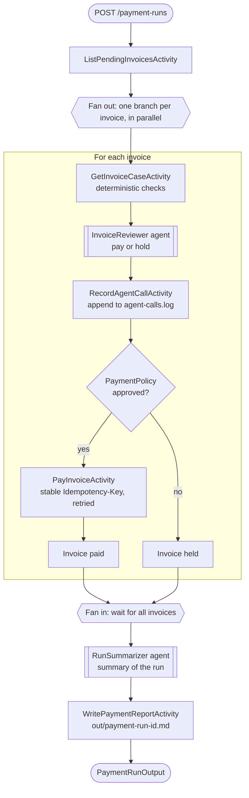

# Durable invoice payments with Microsoft Agent Framework and Dapr Workflow

A .NET Aspire demo of a durable **invoice payment run**. A Dapr Workflow processes a batch of
supplier invoices. For each invoice it runs deterministic checks, asks a MAF agent for a recommendation, and pays the approved invoices through a mock payment provider. Because the run is a workflow, you can kill the app mid-run, restart it, and the run resumes without repeating LLM calls or paying twice.



## What the demo shows

For each pending invoice, `PaymentRunWorkflow` does the following:

1. **Load and check.** The `GetInvoiceCaseActivity` loads the invoice and its purchase order and runs
   three-way-match style checks in code: line totals, supplier, currency, amount over PO
   (2% tolerance) and a changed bank account.
2. **Review.** The `InvoiceReviewer` agent returns a `pay` or `hold` recommendation with a rationale.
   Each agent call runs as a checkpointed workflow activity.
3. **Record.** `RecordAgentCallActivity` appends the call to `out/agent-calls.log`, so you can see
   that LLM calls are not repeated after a crash.
4. **Decide.** `PaymentPolicy` combines the checks and the review in workflow code. The model can
   add caution but can never approve a payment that the checks blocked.
5. **Pay.** `PayInvoiceActivity` calls the payment gateway with a stable `Idempotency-Key`
   derived from the invoice. Activities run at least once, so the key makes a retry or a re-run
   after a crash return the original payment instead of charging twice.
6. **Summarize.** The `RunSummarizer` agent summarizes the run, and `WritePaymentReportActivity`
   writes `out/payment-run-<id>.md`.

### Projects

| Project | Purpose |
|---|---|
| `InvoicePayments.AppHost` | Aspire AppHost. Starts the services, a Valkey state store, the Dapr sidecar and the Dapr Dev Dashboard. |
| `InvoicePayments.ApiService` | The workflow, activities, agents and the HTTP API (port 5090). |
| `InvoicePayments.PaymentGateway` | Mock payment provider that honours `Idempotency-Key` (port 5091). |
| `InvoicePayments.ServiceDefaults` | Shared Aspire service defaults (OpenTelemetry, health checks). |
| `InvoicePayments.Tests` | Unit tests for the checks, policy, idempotency keys and payment store. |
| `data/` | Sample invoices (`INV-1001` to `INV-1008`) and purchase orders. |

### HTTP API

| Method and route | Description |
|---|---|
| `POST /payment-runs` | Start a run. Body: `{ "id": "run-1", "maxInvoices": 8 }`. |
| `GET /payment-runs/{instanceId}` | Status and output of a run. |
| `POST /payment-runs/{instanceId}/pause` | Suspend a run. |
| `POST /payment-runs/{instanceId}/resume` | Resume a suspended run. |
| `POST /payment-runs/{instanceId}/terminate` | Terminate a run. |

The management routes have no authentication. This is fine for a local demo, but add
authorization before you expose the API.

## Prerequisites

- [.NET 10 SDK](https://dotnet.microsoft.com/download)
- [Docker](https://www.docker.com/products/docker-desktop/) (or another container runtime). Aspire uses it for the Valkey state store.
- [Dapr CLI](https://docs.dapr.io/getting-started/install-dapr-cli/), initialized with `dapr init`
- [Diagrid Dapr Dev Dashboard](https://github.com/diagridio/dev-dashboard) (`diagrid-dev-dashboard` on your `PATH`). The AppHost starts it on port 9090.
- An [OpenAI API key](https://platform.openai.com/api-keys). The agents use `gpt-4.1-mini` through a Dapr conversation component.
- For the Catalyst path only: a [Diagrid Catalyst](https://catalyst.diagrid.io/) account and the [Diagrid CLI](https://docs.diagrid.io/getting-started/install-cli).

## Install

```bash
git clone https://github.com/diagrid-labs/durable-maf-agents-payments.git
cd durable-maf-agents-payments
dotnet restore
dotnet test   # optional: runs the unit tests
```

## Run locally with Dapr

In local mode the AppHost starts a Valkey container as the workflow state store (with a data
volume, so state survives restarts), a Dapr sidecar for the API, and the Dev Dashboard.

1. **Add your OpenAI key.** Copy the example secrets file and fill in your key. The file is git-ignored.

   macOS and Linux:

   ```bash
   cp InvoicePayments.AppHost/secrets.example.json InvoicePayments.AppHost/secrets.json
   # edit secrets.json and set "openai-api-key"
   ```

   Windows (PowerShell):

   ```powershell
   Copy-Item InvoicePayments.AppHost/secrets.example.json InvoicePayments.AppHost/secrets.json
   # edit secrets.json and set "openai-api-key"
   ```

2. **Start the app.**

   ```bash
   aspire run
   ```

   The Aspire dashboard opens in your browser. Check that all resources (`statestore`,
   `payment-gateway`, `invoice-payments` and `dev-dashboard`) are running. The `statestore`
   container is sometimes stopped: start it from the dashboard, and wait until all resources are
   running before you continue. Do the same check after every restart in the crash demo below.

3. **Open the Dev Dashboard** at http://localhost:9090 to watch workflow runs, sidecars and components.

4. **Start a payment run** with the REST Client request in `local.http`, or with `curl` or `Invoke-RestMethod`.

   macOS and Linux:

   ```bash
   curl -X POST http://localhost:5090/payment-runs \
     -H "Content-Type: application/json" \
     -d '{ "id": "run-1", "maxInvoices": 8 }'
   ```

   Windows (PowerShell):

   ```powershell
   Invoke-RestMethod -Method Post -Uri http://localhost:5090/payment-runs `
     -ContentType "application/json" `
     -Body '{ "id": "run-1", "maxInvoices": 8 }'
   ```

5. **Check the status** until it is `Completed`.

   macOS and Linux:

   ```bash
   curl http://localhost:5090/payment-runs/run-1
   ```

   Windows (PowerShell):

   ```powershell
   Invoke-RestMethod http://localhost:5090/payment-runs/run-1
   ```

6. **Inspect the results.** Everything is written to the `out/` folder:
   - `payment-run-run-1.md` is the report with each invoice's outcome and the agent's summary.
   - `payments.json` holds the payments the mock provider accepted.
   - `agent-calls.log` has one line per `InvoiceReviewer` agent call.

   Invoices that fail a deterministic check (for example a changed bank account or an amount over
   the PO) are held, even when the agent recommends paying.

7. **Try the crash-and-resume demo.** By default the app does not crash, so the run in steps 4
   to 6 completes normally. To see durability in action, start the app with `SIMULATE_CRASH=true`.
   `PayInvoiceActivity` then kills the API process right after the payment provider accepts the
   second new payment, before the activity result is checkpointed. You then restart the app
   without the variable, and the workflow resumes.

   1. Stop the running app with `Ctrl+C` in the terminal where `aspire run` is running.
   2. Reset the demo state by removing the Valkey container, the state volume and the `out/`
      folder. Docker refuses to remove the volume while a container still uses it, even a
      stopped one, so the container has to be removed first.

      macOS and Linux:

      ```bash
      docker rm -f invoice-payments-state
      docker volume rm invoice-payments-state-data
      rm -rf out
      ```

      Windows (PowerShell):

      ```powershell
      docker rm -f invoice-payments-state
      docker volume rm invoice-payments-state-data
      Remove-Item -Recurse -Force out
      ```

   3. Start the app with the crash enabled.

      macOS and Linux:

      ```bash
      SIMULATE_CRASH=true aspire run
      ```

      Windows (PowerShell):

      ```powershell
      $env:SIMULATE_CRASH = "true"
      aspire run
      ```

   4. Start a run with the id `run-crash`. The API process dies mid-run, so the request may
      fail or the connection may close. That is expected.

      macOS and Linux:

      ```bash
      curl -X POST http://localhost:5090/payment-runs \
        -H "Content-Type: application/json" \
        -d '{ "id": "run-crash", "maxInvoices": 8 }'
      ```

      Windows (PowerShell):

      ```powershell
      Invoke-RestMethod -Method Post -Uri http://localhost:5090/payment-runs `
        -ContentType "application/json" `
        -Body '{ "id": "run-crash", "maxInvoices": 8 }'
      ```

      The crash kills only the API process. The payment gateway keeps running, so after a few
      seconds the `out/` folder shows the state at the moment of the crash:

      - `agent-calls.log` has one line (timestamp, invoice id, supplier) for each invoice whose
        agent review had completed. The invoices run in parallel, so which ones are listed and
        in what order varies per run.
      - `payments.json` has the payments the provider accepted before the crash: the second new
        payment is in there even though the API never received the response. Other invoices that
        were being paid in parallel at that moment may be in there too.
      - There is no `payment-run-run-crash.md` yet, because the run did not finish.

      Open the **Workflows** page of the Dapr Dev Dashboard at http://localhost:9090 to see the
      same picture from the workflow engine's side. The `PaymentRunWorkflow` instance
      `run-crash` stays in the `Running` state, and so do some of the `AgentRunWorkflow`
      instances. These wrap the MAF agent calls, one per invoice review, and the run also has
      one for the run summary once it gets that far. They cannot make progress, because the
      `invoice-payments` app that executes the workflow and activity code has crashed. The agent
      runs that already finished are shown as `Completed`.

   5. Stop the Aspire run process (`Ctrl+C`), then start the app again **without** the crash environment variable.

      macOS and Linux:

      ```bash
      aspire run
      ```

      Windows (PowerShell):

      ```powershell
      Remove-Item Env:SIMULATE_CRASH
      aspire run
      ```

   6. The workflow resumes from its history. Check the status of `run-crash` (as in step 5, with
      `run-crash` in the URL) until it is `Completed`. The **Workflows** page of the
      Dapr Dev Dashboard will show that the `PaymentRunWorkflow` and all the `AgentRunWorkflow` instances that were stuck in `Running` are now `Completed`, because the restarted app picked up their
      history and finished the work. Compare `out/` with what you saw after the crash:

      - `agent-calls.log` lists each invoice exactly once. The LLM calls recorded before the
        crash were not repeated, and the new lines after a visible time gap are the invoices
        that were not reviewed yet.
      - `payments.json` has one payment per paid invoice and no duplicates. The payments from
        before the crash keep their original payment ids: when the workflow re-ran
        `PayInvoiceActivity`, the provider recognised the idempotency key and returned the
        original payment (an `Idempotent-Replayed` warning in the gateway logs) instead of
        charging again.
      - `payment-run-run-crash.md` now exists. It holds the outcome of every invoice and the
        agent's summary. Invoices that failed a check, such as `INV-1004` which has no purchase
        order, are held and have no payment.

8. **Stop the app** with `Ctrl+C`.

## Run with Diagrid Catalyst

On Catalyst, the workflow engine and its state store are managed by Diagrid, so the AppHost skips
the local Valkey container, Dapr sidecar and Dev Dashboard. The API connects to a Catalyst-managed
Dapr runtime instead. The AppHost switches to Catalyst mode when `DAPR_GRPC_ENDPOINT` is set in
the environment that launches it.

1. **Log in to Catalyst.**

   ```bash
   diagrid login
   ```

2. **Create a project** with managed workflow enabled and make it the default project for this
   session. The managed workflow store is where Catalyst keeps the workflow state.

   ```bash
   diagrid project create invoice-payments-demo --enable-managed-workflow --deploy-managed-kv --deploy-managed-pubsub --wait --use
   ```

3. **Create an agent** for the app. Its name is the app id of the API.

   ```bash
   diagrid agent create invoice-payments --wait
   ```

4. **Create the conversation component** that the agents use for the LLM, with the same name
   as in `InvoicePayments.AppHost/resources/conversation.yaml`. In Catalyst the key is stored
   in the component, so you do not need `secrets.json`.

   macOS and Linux:

   ```bash
   diagrid component create conversation-openai \
     --type conversation.openai \
     --metadata key="$OPENAI_API_KEY" \
     --metadata model=gpt-4.1-mini \
     --scopes invoice-payments --wait
   ```

   Windows (PowerShell):

   ```powershell
   diagrid component create conversation-openai `
     --type conversation.openai `
     --metadata key="$env:OPENAI_API_KEY" `
     --metadata model=gpt-4.1-mini `
     --scopes invoice-payments --wait
   ```

5. **Get the connection details** of the `invoice-payments` agent (the gRPC endpoint, HTTP
   endpoint and API token) from the Catalyst console, export them and start the app from the
   same shell.

   macOS and Linux:

   ```bash
   export DAPR_GRPC_ENDPOINT="<grpc endpoint of the invoice-payments agent>"
   export DAPR_HTTP_ENDPOINT="<http endpoint of the invoice-payments agent>"
   export DAPR_API_TOKEN="<api token of the invoice-payments agent>"
   aspire run
   ```

   Windows (PowerShell):

   ```powershell
   $env:DAPR_GRPC_ENDPOINT = "<grpc endpoint of the invoice-payments agent>"
   $env:DAPR_HTTP_ENDPOINT = "<http endpoint of the invoice-payments agent>"
   $env:DAPR_API_TOKEN = "<api token of the invoice-payments agent>"
   aspire run
   ```

   Check in the Aspire dashboard that `payment-gateway` and `invoice-payments` are running.
   There is no `statestore` or `dev-dashboard` resource in this mode.

6. **Start a payment run and check its status** with the same commands as in local steps 4 and 5.

7. **Watch the run in Catalyst.** Open the [Catalyst console](https://catalyst.diagrid.io/) and go
   to the workflows of your project. The `PaymentRunWorkflow` and the `AgentRunWorkflow` instances appear, with their activity history.

8. **Try the crash-and-resume demo.** Follow local step 7 with these changes: the workflow state
   lives in Catalyst, so there is no container or volume to remove. Keep the three `DAPR_*`
   variables set when you restart the app, set `SIMULATE_CRASH` in the shell before the first
   start and remove it before the second one. Use a new run id for each attempt, and look at the
   workflows in the Catalyst console where the local steps use the Dev Dashboard.

9. **Clean up.** Stop the app with `Ctrl+C`, remove the three `DAPR_*` variables to go back to
   local mode, then delete the Catalyst project:

   ```bash
   diagrid project delete invoice-payments-demo
   ```

